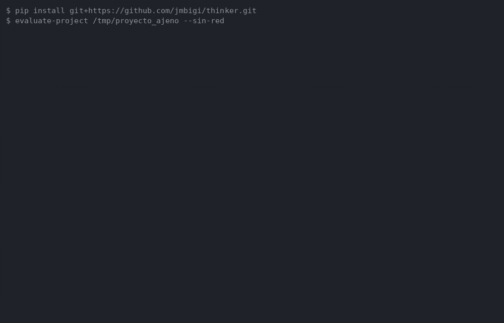

# thinker

Sistema de investigación profunda con LLM: descompone una pregunta, recupera
fuentes reales, extrae afirmaciones, evalúa la evidencia y redacta un informe
trazable. Incluye una capa de **pensamiento estructurado** en pasos validados y
herramientas de análisis estático de código.

> **Herramienta real**, en desarrollo activo: funcional, verificada y con las
> limitaciones documentadas al final. Incluye modos **demo offline** (`MockLLM`,
> `MockSearchAPI`) como **ayuda** para probarla sin red ni API keys; con
> proveedores reales ejecuta investigación real. Todavía no se declara lista
> para producción.

## Qué contiene

| Módulo | Función |
|---|---|
| `deep_research_system.py` | Pipeline de investigación: descomposición, recuperación, extracción de claims, evaluación y reporte. |
| `llm_providers.py` | Proveedores LLM (OpenAI, OpenRouter, Kilo, DeepSeek, Ollama, Mock). Reintentos con backoff y caché en las rutas OpenAI-compatibles; Ollama y Mock no reintentan. |
| `thinking_engine.py` | Motor común de ciclos de pensamiento por pasos con validación antes de avanzar (sin duplicación) + Tree of Thoughts (BFS/DFS/Beam). |
| `pensamiento_layer.py` | Los 7 pasos de pensamiento para investigación + orquestador con pensamiento. |
| `code_design_improvement_tools.py` | Análisis estático de Python (AST) y ciclo de pensamiento para decisiones de diseño. |
| `web_search.py` | Búsqueda real sin API key (Wikipedia, DuckDuckGo) y mock offline, con formulación de consulta. |
| `plugins/` | Sistema de plugins con hot-swap (proveedores LLM y búsqueda, extensiones del núcleo) + CLI de gestión. Config: `config/plugins.yaml`; guía: `docs/PLUGINS.md`. |
| `tests/benchmarks/` | Framework de benchmark por dominio con rúbricas y LLM-as-judge opcional (`--list` para ver las tareas). |
| `docs/LECCIONES-APRENDIDAS.md` | Memoria del proyecto: hallazgos, causas y soluciones. |
| `docs/REFERENCIAS-IA.md` | Teoría y práctica de IA (referencias verificadas contra arXiv y guías de ingeniería) con propuestas medidas por el benchmark. |
| `evaluar_proyecto.py` | Evaluación estática y **read-only** de un proyecto externo en 6 dimensiones (funcionalidades, calidad, vigencia, herramientas, inteligencia, eficiencia) con criterios binarios, evidencia por hallazgo, **plan de mejora derivado de las métricas** y, opt-in, síntesis del modelo con control anti-invención y dudas investigadas con fuentes. Informes: `docs/EVALUACIONES.md`. |
| `AGENTS.md` | Reglas de trabajo para agentes de IA (ruleset P0/P1/P2 + reglas propias). |

## Requisitos

- **Requisitos**
  - Python 3.11 o superior (verificado en 3.11 y 3.12).
  - Dependencias: `requests`, `openai>=1.0,<4`, `python-dotenv`, `PyYAML` (ver
    `requirements.txt`; el lock fija las exactas con hashes). `openai` verificado
    en 1.109.1, 2.54.0, 3.33.0 y 3.35.1 (lock en 3.35.1).
  - Opcional: [Ollama](https://ollama.com/) para modelos locales.

## Instalación

```bash
python3 -m venv .venv
source .venv/bin/activate

# Opción reproducible (versiones fijadas con hashes):
python3 -m pip install --require-hashes -r requirements.lock

# Opción rápida (rangos de versión):
pip install -r requirements.txt
```

## Uso desde otros proyectos (paquete instalable)

El proyecto `thinker` se distribuye como el paquete pip `thinker-research`:
otros proyectos pueden usarlo como librería o como herramienta de consola.

```bash
pip install .                                  # desde una copia del repo
pip install git+https://github.com/jmbigi/thinker.git   # directo del remoto
pip install git+https://github.com/jmbigi/thinker.git@v0.1.3   # tag fijado (verifica el remoto)
pip install thinker-research==0.1.3            # desde PyPI
```

La versión `0.1.3` está publicada en PyPI. La instalación por tag sigue
disponible y no requiere PyPI ni claves. Estado de la publicación:
`docs/PUBLICACION.md`.

Como **herramienta de consola** (evalúa y recomienda mejoras a OTRO proyecto,
estática y read-only):

```bash
evaluate-project RUTA_DEL_PROYECTO --sin-red   # añade --ejecutar-tests (opt-in)
```



*(Captura real: la salida del GIF es verbatim de una ejecución de
`evaluate-project` sobre un proyecto con defectos plantados — GLOBAL 0.344 y
19 propuestas; solo el ritmo de aparición del texto es presentación.)*

Como **librería** (los módulos públicos quedan importables):

```python
from evaluar_proyecto import evaluar            # evaluar un proyecto: dict completo
from pensamiento_layer import DeepResearchThinkingLayer
from deep_research_system import ResearchOrchestrator
from code_design_improvement_tools import CodeImprovementOrchestrator
from llm_providers import MockLLM               # + OpenRouterLLM, OllamaLLM...
from web_search import MockSearchAPI            # + Wikipedia/DuckDuckGo
```

Notas honestas: el registro de plugins usa rutas relativas por defecto
(`plugins/`, `config/plugins.yaml`); desde otro proyecto pasa `plugin_dirs` y
`config_path` explícitos a `PluginRegistry`. El paquete instalado `scripts`
existe porque el evaluador importa `scripts.preflight`; tenlo en cuenta si tu
proyecto ya instala un paquete con ese nombre. `tests` no se instala (un
`tests` raíz en site-packages colisionaría con otros proyectos): el benchmark
se ejecuta desde el repo con `python3 -m tests.benchmarks.run_bench`.

## Uso rápido — modo demo offline (sin red ni API keys)

```bash
python3 deep_research_system.py            # pipeline completo (LLM y búsqueda simulados)
python3 pensamiento_layer.py               # ciclo de pensamiento de 7 pasos
python3 code_design_improvement_tools.py   # análisis estático + decisiones de diseño
```

Es el modo **demo**: una ayuda para probar y comprender el sistema. `MockLLM` y
`MockSearchAPI` están declarados como simulados y no producen investigación
real; con proveedores y buscadores reales (sección siguiente), sí.

## Uso real (OpenRouter con modelos gratuitos)

1. Copia `.env.example` a `.env` y pon tu clave de OpenRouter:
   `OPENROUTER_API_KEY=...` (el archivo `.env` está en `.gitignore`).
2. Opcional: elige otro modelo gratuito con `OPENROUTER_MODEL`
   (por defecto `poolside/laguna-xs-2.1:free`, coste 0).
3. Ejecuta la verificación real de extremo a extremo:

```bash
python3 test_openrouter_real.py     # conexión + pensamiento + pipeline (modelo :free)
python3 test_env_usage.py --real    # integración de la clave .env
python3 openrouter_integration_demo.py --real
```

Con **Ollama local** (sin API key, sin coste; requiere `ollama serve`):

```bash
python3 test_ollama_real.py         # conexión + pensamiento + pipeline con LLM local
OLLAMA_MODEL=qwen3:8b python3 test_ollama_real.py   # otro modelo local
```

Para usar búsqueda web real en el pipeline:

```python
from deep_research_system import OpenRouterLLM, ResearchOrchestrator
from web_search import WikipediaSearchAPI      # o DuckDuckGoSearchAPI

report, ctx = ResearchOrchestrator(OpenRouterLLM(), WikipediaSearchAPI()).research(
    "¿Cuál es el estado actual de la fusión nuclear?"
)
```

Verificación independiente (segunda pasada tipo CoVe) con proveedor SEPARADO
del generador —la independencia se declara por claim en el contexto y en el
`decision_log` (`proveedor-distinto`; sin verificador separado se ejecuta igual
pero queda declarada como `mismo-proveedor`, nunca silenciosa):

```python
report, ctx = ResearchOrchestrator(
    OpenRouterLLM(),                                  # generador y evaluador
    WikipediaSearchAPI(),
    verificacion_independiente=True,
    llm_verificador=OpenRouterLLM(model="otro-modelo:free"),  # verificador CoVe
).research("¿Cuál es el estado actual de la fusión nuclear?")
```

Modos piloto opt-in (desactivados por defecto; ver Hallazgo 76 en
`docs/LECCIONES-APRENDIDAS.md`):

- `congelar_fases=True` en el motor de pensamiento: cada fase ejecutada se
  congela con su hash y las fases posteriores la reciben como INMUTABLE en el
  prompt (no aplica a ToT, y lo declara).
- `muestras_consenso>1` en el pipeline: repite la evaluación de cada claim y
  marca `discrepancia_muestreo` si los veredictos divergen (señal de juicio
  inestable o alucinación); el coste extra queda declarado por claim.
  Benchmark offline: `python3 tests/benchmarks/consenso_muestreo.py`.

## Verificación

```bash
make check                                    # lint + preflight + tests + secretos + ci + hook
make lint                                     # ruff check .
make preflight                                # gates deterministas (imports, silencios, duplicados, tareas)
make test                                     # suite unittest (stdlib)
make coverage                                 # cobertura de los módulos de producción
make secrets                                  # escaneo de secretos/datos personales
make sbom                                     # inventario de dependencias (syft si está)
make vuln-scan                                # pip-audit sobre requirements.lock
make mutation                                 # pruebas de mutación (mutmut)
make ci                                       # CI local: verifica una copia limpia de HEAD
make lock                                     # regenera requirements.lock con hashes
make hook                                     # instala el hook pre-commit de git
```

Equivalente sin `make`:

```bash
ruff check .
python3 scripts/preflight.py                  # gates estáticos deterministas (AST, offline)
python3 -m unittest discover -s tests -v
python3 -m coverage run --source=. -m unittest discover -s tests && python3 -m coverage report -m
bash scripts/scan-secrets.sh
python3 honest_test.py                        # comprobación honesta del sistema
python3 evaluar_proyecto.py RUTA              # evaluación externa (6 dimensiones, read-only)
python3 scripts/probe_model.py --samples 5    # sonda de latencia del modelo (opt-in)
```

El hook `.git/hooks/pre-commit` (instalado con `make hook`) ejecuta ruff, el
escaneo de secretos, `py_compile`, el preflight y la suite antes de cada
commit.

## Limitaciones conocidas (sin adornos)

- El pipeline con `MockSearchAPI` **no hace investigación real**: las fuentes son
  ficticias. Con `WikipediaSearchAPI`/`DuckDuckGoSearchAPI` sí recupera fuentes
  reales, pero la calidad depende de esas fuentes.
- Los dos orquestadores (`ResearchOrchestrator` y
  `ResearchOrchestratorWithThinking`) usan **el mismo pipeline real** de
  evidencias; la calidad del informe depende del modelo y del buscador
  configurados, no de heurísticas locales.
- Los modelos gratuitos de OpenRouter tienen límites de tasa y errores 5xx
  transitorios; el código reintenta con backoff, pero la intermitencia persiste.
- No hay integración continua en la nube (la verificación es local, por diseño).
- Verificado en Linux con Python 3.11 y 3.12; no se ha probado en Windows ni
  macOS (los scripts son `bash`; el código Python no usa rutas de sistema).
- La suite mata el **94,7%** de los mutantes de `mutmut` (3581/3780; 199
  supervivientes, 0 timeouts, 0 sospechosos; medición 2026-10-21, excluyendo
  las líneas `print`, que solo generan mutantes equivalentes): cobertura alta
  no equivale a tests fuertes. Mediciones anteriores: 94,7% (3570/3769),
  94,1% (3567/3789), 79,8% (3022/3789), 79,9% (2863/3582) y 78,1%
  (2766/3543).

## Licencia

**GNU General Public License v3.0** (`GPL-3.0-only`). Texto legal completo en
[`LICENSE`](LICENSE) (copia verbatim de
<https://www.gnu.org/licenses/gpl-3.0.txt>).

Las reglas de `AGENTS.md` derivan de
[better-ai](https://github.com/jmbigi/better-ai) (CC BY-SA 4.0) y
[better-project](https://github.com/jmbigi/better-project) (GPL-3.0-or-later),
con atribución conservada. Esto no constituye asesoramiento legal: si vas a
distribuir el proyecto, revisa la compatibilidad de licencias con tu caso.

## Reglas del proyecto

Las reglas de trabajo (verificación con evidencia, no destrucción, no secretos,
alcance, honestidad) están en [`AGENTS.md`](AGENTS.md), derivadas de
[better-ai](https://github.com/jmbigi/better-ai) y
[better-project](https://github.com/jmbigi/better-project).
