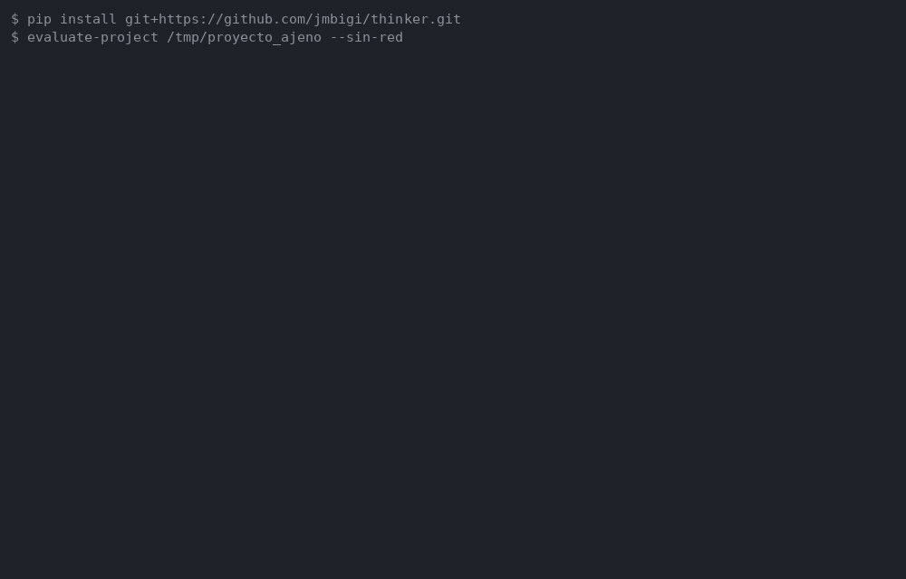
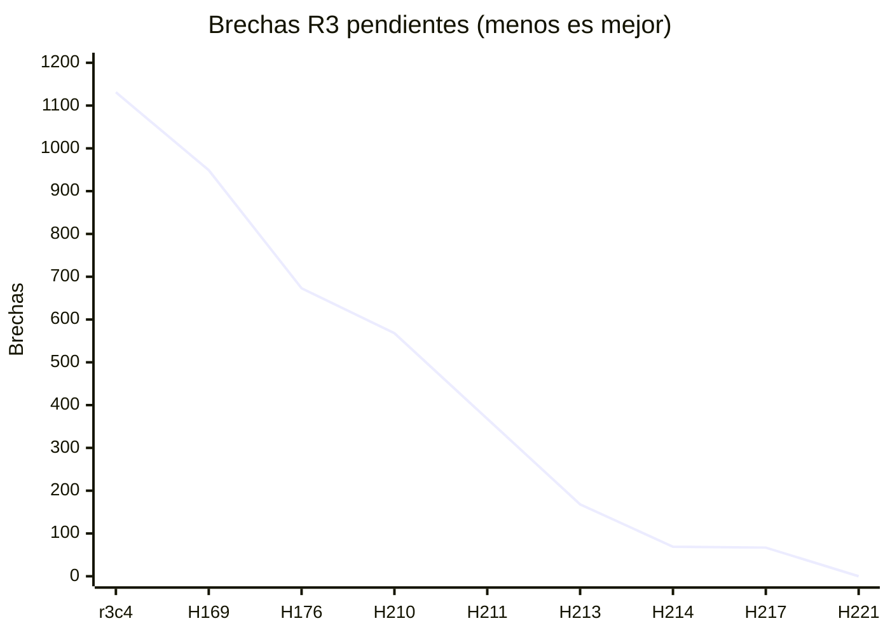
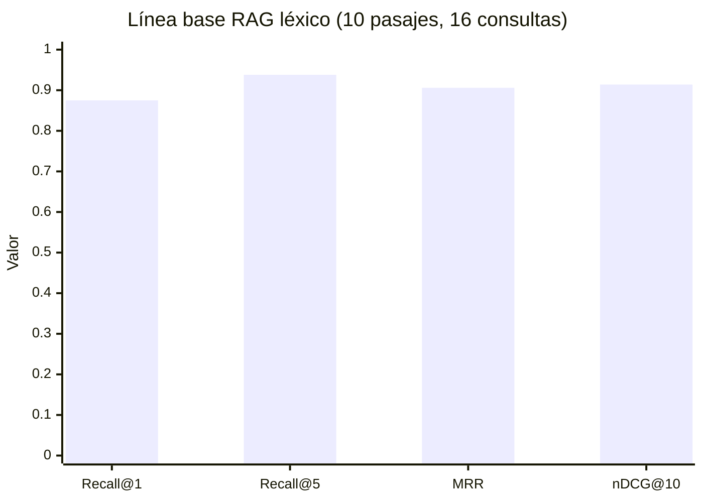

# thinker

Sistema de investigación profunda con LLM: descompone una pregunta, recupera
fuentes reales, extrae afirmaciones, evalúa la evidencia y redacta un informe
trazable. Incluye una capa de **pensamiento estructurado** en pasos validados y
herramientas de análisis estático de código.

> **Herramienta real**, en desarrollo activo: funcional, verificada y con las
> limitaciones documentadas al final. Incluye modos **demo offline** (`MockLLM`,
> `MockSearchAPI`) como **ayuda** para probarla sin red ni API keys; con
> proveedores reales ejecuta investigación real. Todavía no se declara lista
> para producción.

## Qué contiene

| Módulo | Función |
|---|---|
| `deep_research_system.py` | Pipeline de investigación: descomposición, recuperación, claims, evaluación y reporte. CoVe, consenso, checkpoints reanudables, paralelismo determinista y routing/poda adaptativos. |
| `citation_verifier.py` | Verificación determinista de citas: existencia y fragmento (`EXACT_MATCH`/`FOUND`/`NOT_FOUND`/`UNVERIFIABLE`) separados del soporte (`SUPPORTED`/`PARTIALLY_SUPPORTED`/`CONTRADICTED`/`UNVERIFIABLE`) y duplicados por URL normalizada sin descartar puertos ni parámetros de contenido. Léxica, no semántica. |
| `source_quality.py` | Dimensiones separadas de autoridad, independencia, actualidad, relevancia, soporte y trazabilidad. Sin nota única; una fecha futura o un claim sin fuente asociada queda no evaluable. Heurísticas declaradas. |
| `documents.py` | Contenido completo HTML/PDF/TXT/Markdown/CSV y Office Open XML, pasajes con hash/localización, RAG local BM25+coseno y full-text web. |
| `research_cli.py` | CLI real `research`: proveedores, buscadores, documentos, Markdown/JSON, estado, presupuestos y opciones opt-in. Sin argumentos conserva la demo. |
| `research_state.py` | Checkpoints idempotentes con esquema versionado, caché de recuperación y escritura atómica 0600. |
| `llm_providers.py` | Proveedores LLM (OpenAI, OpenRouter, Kilo, DeepSeek, deepseek-free-agent, Ollama, Mock). Reintentos con backoff en APIs compatibles, caché y presupuesto seguro entre hilos. |
| `thinking_engine.py` | Motor común de ciclos de pensamiento por pasos con validación antes de avanzar (sin duplicación) + Tree of Thoughts (BFS/DFS/Beam). |
| `pensamiento_layer.py` | Los 7 pasos de pensamiento para investigación + orquestador con pensamiento. |
| `code_design_improvement_tools.py` | Análisis estático de Python (AST) y ciclo de pensamiento para decisiones de diseño. |
| `web_search.py` | Wikipedia, DuckDuckGo, SearXNG, arXiv, PubMed y Semantic Scholar + mock offline y formulación de consulta. |
| `mcp_client.py` | Cliente MCP stdio oficial: negociación, allowlist, sin shell ni herencia de secretos, timeout y límite de salida. |
| `concept_ncm.py` | NCM conceptual: esquema→secciones→residuales, trazas hash, paralelismo por nivel y reconstrucción determinista; no es el modelo neural del paper. |
| `privacy.py` | Políticas `public`, `local-only`, `private-documents` y checkpoints cifrados con Fernet. |
| `efficiency.py` | Routing heurístico, poda RAG, caché exacta/semántica, vectores INT4/INT8, expertos y draft-verificación. |
| `neural_concepts.py` | Extra `ml` con modelos pequeños reales: destilación, LoRA, cuantización/poda de pesos, MoE, speculative decoding y VQ residual. No afirma calidad de producción. |
| `plugins/` | Sistema de plugins con hot-swap (proveedores LLM y búsqueda, extensiones del núcleo) + CLI de gestión. `ResearchOrchestrator.from_plugins()` usa los proveedores activos y conecta los hooks de investigación. Config: `config/plugins.yaml`; guía: `docs/PLUGINS.md`. |
| `tests/benchmarks/` | Framework de benchmark por dominio con rúbricas y LLM-as-judge opcional (`--list` para ver las tareas). |
| `docs/LECCIONES-APRENDIDAS.md` | Memoria del proyecto: hallazgos, causas y soluciones. |
| `docs/RECOMENDACIONES-MEJORAS.md` | Recomendaciones abiertas priorizadas, con evidencia, esfuerzo, riesgo y criterio de aceptación. |
| `docs/REFERENCIAS-IA.md` | Teoría y práctica de IA (referencias verificadas contra arXiv y guías de ingeniería) con propuestas medidas por el benchmark. |
| `docs/GUIA-NCM.md` | Las cuatro acepciones de NCM (Next-Concept Modeling, mapas cognitivos neuronales y neutrosóficos, Nearest Class Mean): repositorios, licencias y fuentes verificadas (anexo A). |
| `evaluar_proyecto.py` | Evaluación estática y **read-only** de un proyecto externo en 6 dimensiones, con perfil de lenguajes/manifiestos/locks y **criterios N/A** que no se cuentan como fallos; declara cobertura y ratio. Evidencia por hallazgo ligada a su criterio, **plan de mejora derivado de las métricas** y, opt-in, síntesis del modelo con control anti-invención y dudas investigadas con fuentes. Traduce rangos Poetry `^`/`~` a PEP 508 y conserva su cota inferior en el informe. Incluye **verificación opt-in de requisitos** (`--requisitos`, ver `docs/REQUISITOS.md`). Informes: `docs/EVALUACIONES.md`. |
| `AGENTS.md` | Reglas de trabajo para agentes de IA (ruleset P0/P1/P2 + reglas propias). |

## Requisitos

- **Requisitos**
  - Python 3.11 o superior (verificado en 3.11/3.12 en Linux y en
    3.12.7/3.14.3 en Windows 11).
  - Dependencias: `requests`, `openai>=1.0,<4`, `python-dotenv`, `PyYAML`,
    `pypdf`, `cryptography` y `packaging` (ver `requirements.txt`; el lock fija
    las exactas con hashes). `openai` verificado en 1.109.1, 2.54.0, 3.33.0,
    3.35.1, 3.36.1, 3.37.0, 3.40.0, 3.42.0, 3.42.1 y 3.45.0 (lock en 3.45.0).
  - Opcional: [Ollama](https://ollama.com/) para modelos locales;
    `deepseek-free-agent` con Node.js ≥18 y Chromium para DeepSeek web sin API
    key ([instalación y riesgos](docs/DEEPSEEK-FREE-AGENT.md)); extra `ml` con
    `torch==2.15.0` (`requirements-ml.txt` + `requirements-ml.lock`).

## Instalación

```bash
python3 -m venv .venv
source .venv/bin/activate        # Linux/macOS
# .venv\Scripts\Activate.ps1    # Windows PowerShell (usa `python`, no `python3`)

# Opción reproducible (versiones fijadas con hashes):
python3 -m pip install --require-hashes -r requirements.lock

# Opción rápida (rangos de versión):
pip install -r requirements.txt
```

El subsistema neural es opt-in y no forma parte de la instalación base:

```bash
pip install ".[ml]"
python3 -m pip install --require-hashes -r requirements-ml.lock
```

En Windows, `python3` no siempre existe o puede apuntar a otro intérprete; usa
`python` (o la ruta explícita) y el activador de PowerShell/cmd.

## Uso desde otros proyectos (paquete instalable)

El proyecto `thinker` se distribuye como el paquete pip `thinker-research`:
otros proyectos pueden usarlo como librería o como herramienta de consola.

```bash
pip install .                                  # desde una copia del repo
pip install git+https://github.com/jmbigi/thinker.git   # directo del remoto
pip install git+https://github.com/jmbigi/thinker.git@v0.1.23   # tag fijado (verifica el remoto)
pip install thinker-research==0.1.23            # desde PyPI
```

`thinker-research` se instala desde PyPI o desde un tag verificado, sin claves
para el usuario. Cada publicación se comprueba con instalaciones limpias desde
TestPyPI y PyPI; el estado y las evidencias están en `docs/PUBLICACION.md`.

Como **herramienta de consola** (evalúa y recomienda mejoras a OTRO proyecto,
estática y read-only):

```bash
evaluate-project RUTA_DEL_PROYECTO --sin-red   # añade --ejecutar-tests (opt-in)
```



*(Captura histórica y verbatim de una ejecución del evaluador anterior a v2
sobre un proyecto con defectos plantados — GLOBAL 0.344 y 19 propuestas; solo
el ritmo de aparición del texto es presentación. El evaluador v2 añade perfil,
cobertura y criterios N/A: ver `docs/EVALUACIONES.md` para las cifras actuales.)*

El informe `--json` es un contrato versionado: incluye `schema_version: 2` y
los campos `cobertura`, `global_nota`, `no_verificado`,
`licencias_no_runtime` (dependencias de desarrollo/opcionales, informativas y
fuera del score `h5`) y `aserciones_debiles` (señal informativa separada de
c5). La cobertura incluye `comparable`, `motivo_no_comparable` y
`nota_lenguajes`: con cobertura baja el GLOBAL se rotula «NO COMPARABLE». Un
consumidor debe comprobar `schema_version` antes de asumir el resto del
esquema.

### Verificar una lista de requisitos

Además del rubric fijo, el evaluador puede contrastar requisitos declarados por
ti contra el código y los tests:

```bash
evaluate-project RUTA --requisitos requisitos.md
evaluate-project RUTA --requisitos requisitos.md --ejecutar-tests
```

El archivo es Markdown estructurado (`## ID: título` + `- Enunciado:` +
`- Criterio de aceptación:` + `- Verificación:` + `- Evidencia:`). Los
veredictos son `CUMPLE` (suite verde), `CUBIERTO` (evidencia estática),
`NO CUMPLE` y `NO VERIFICABLE`; el informe es aparte y **no altera el GLOBAL**.
Formato completo, métodos y límites: `docs/REQUISITOS.md`.

### Auditar cambios de agentes

El auditor de cambios revisa un diff y marca señales mecánicas de cambios no
solicitados: rutas prohibidas, tests debilitados, cobertura rebajada,
supresiones, dependencias nuevas, requisitos modificados y diff excesivo. No
detecta intención ni autoría; es una capa de evidencia para revisión humana.

```bash
python3 scripts/audit_changes.py --staged
python3 scripts/audit_changes.py --base origin/main --json
make audit-diff BASE=origin/main
```

Reglas, veredictos y límites: `docs/AUDITORIA-CAMBIOS.md`.

### Holdout independiente

`holdout/` no se descubre con `make test`. El runner verifica el SHA-256 de
cada test contra `holdout/HASHES.json` y después los ejecuta; si un test cambió
sin actualizar el manifiesto, falla:

```bash
python3 scripts/run_holdout.py
make holdout
```

El hook pre-commit y `make ci` ejecutan auditor y holdout. Es
**tamper-evidence**, no una protección criptográfica: el control real es
ejecutarlo fuera del alcance de escritura del agente y revisar sus cambios.

Como **librería** (los módulos públicos quedan importables):

```python
from evaluar_proyecto import evaluar            # evaluar un proyecto: dict completo
from pensamiento_layer import DeepResearchThinkingLayer
from deep_research_system import ResearchOrchestrator
from code_design_improvement_tools import CodeImprovementOrchestrator
from llm_providers import MockLLM               # + OpenRouterLLM, OllamaLLM...
from web_search import MockSearchAPI            # + Wikipedia/DuckDuckGo
```

Notas honestas: el registro de plugins usa rutas relativas por defecto
(`plugins/`, `config/plugins.yaml`); desde otro proyecto pasa `plugin_dirs` y
`config_path` explícitos a `PluginRegistry`. El paquete instalado `scripts`
existe porque el evaluador importa `scripts.preflight`; tenlo en cuenta si tu
proyecto ya instala un paquete con ese nombre. `tests` no se instala (un
`tests` raíz en site-packages colisionaría con otros proyectos): el benchmark
se ejecuta desde el repo con `python3 -m tests.benchmarks.run_bench`.

## Uso rápido — modo demo offline (sin red ni API keys)

```bash
python3 deep_research_system.py            # pipeline completo (LLM y búsqueda simulados)
python3 pensamiento_layer.py               # ciclo de pensamiento de 7 pasos
python3 code_design_improvement_tools.py   # análisis estático + decisiones de diseño
```

Es el modo **demo**: una ayuda para probar y comprender el sistema. `MockLLM` y
`MockSearchAPI` están declarados como simulados y no producen investigación
real; con proveedores y buscadores reales (sección siguiente), sí.

## CLI de investigación real

`research` acepta una pregunta y opciones; sin argumentos conserva la demo
anterior. La salida va a stdout o a `--output`, mientras configuración, progreso
y errores van a stderr. Con `mock`, la salida se marca como simulada.

```bash
# Protocolo offline (SIMULADO; no mide calidad real):
research "Compara RAG y MCP" --format json

# Investigación real con Ollama local (requiere ollama serve):
research "Compara RAG y MCP" --provider ollama --search wikipedia

# Documentos locales, salida JSON y reanudación:
research "Resume la evidencia" --provider ollama \
  --documents ./corpus --format json --state investigacion.json
```

Formatos: `.txt`, `.md`, `.csv`, `.html`, `.pdf`, `.docx`, `.pptx` y `.xlsx`.
Los pasajes conservan `sha256`, `location`, `fetched_at` y contenido. La RAG
local combina BM25 y coseno vectorial léxico, **no afirma embeddings semánticos**.
Para contenido web completo (no solo snippets) usa `--full-text` con un buscador
web real; las descargas parciales se reportan y el fallo total no cae a snippets.

```bash
# Web completa + SearXNG local explícito:
SEARXNG_URL=http://localhost:8080 research "Fusión nuclear" \
  --provider ollama --search searxng --allow-private-search --full-text

# SearXNG, arXiv, PubMed y Semantic Scholar también disponibles:
research "CRISPR" --provider openrouter --search pubmed

# Cliente MCP explícito (servidor confiable, sin shell):
research "Evidencia" --provider ollama --search mcp \
  --mcp-command "python servidor_mcp.py" --mcp-tool search --mcp-timeout 10
```

El estado contiene fuentes y claims; puede ser sensible. Para cifrarlo, genera
una clave Fernet y guárdala como secreto de entorno (nunca se escribe en estado):

```bash
export THINKER_STATE_KEY="$(python3 -c 'from cryptography.fernet import Fernet; print(Fernet.generate_key().decode())')"
research "Investiga documentos" --provider ollama --documents ./corpus \
  --privacy private-documents --state privado.bin --encrypt-state
```

`public` permite web/nube; `local-only` restringe endpoints locales pero
SearXNG puede reenviar consultas; `private-documents` solo documentos y modelos
locales. No son un *air gap*: MCP no ofrece garantía de egreso local y queda
fuera de esos dos modos.

NCM conceptual y eficiencia opt-in:

```bash
research "Compara arquitecturas RAG" --provider ollama \
  --ncm-residual --max-workers 2 \
  --adaptive --prune-context --context-passages 6 --context-chars 2400 \
  --cache --cache-bits 4
```

- NCM: esquema→secciones→refinamientos residuales con hashes, paralelismo por
  nivel y reconstrucción determinista. **No es el tokenizer VQ ni el transformer
  NCM del paper** (`docs/GUIA-NCM.md`).
- `--adaptive`: routing heurístico declarado; no es un clasificador calibrado.
- `--prune-context`: métricas reales de ahorro en `decision_log`.
- `--cache`: exacta; `--semantic-cache-threshold` además activa similitud léxica
  opt-in. `--cache-bits 4|8` cuantiza vectores de la caché, no pesos del LLM.
- `--speculative`: draft-verificación, no decodificación especulativa por tokens.
- `--max-llm-calls`: presupuesto por proveedor, seguro entre hilos.

Benchmark externo (rúbricas locales; no RACE/FACT oficiales):

```bash
python3 -m tests.benchmarks.external --dataset query.jsonl --kind drb \
  --provider mock --max-tasks 2 --json
python3 -m tests.benchmarks.external --dataset claims.jsonl --kind attribution
```

El extra `ml` (`neural_concepts.py`) implementa con PyTorch y modelos diminutos
reales: destilación con logits, LoRA, cuantización/poda de pesos, MoE,
decodificación especulativa verificada y VQ residual. Es un banco de validación
mecánica en CPU, **no una demostración de mejora de calidad del LLM de producción**.

## Uso real sin API key ni cobro: deepseek-free-agent

Con el servicio externo configurado y la sesión iniciada:

```bash
research "Compara RAG y MCP" \
  --provider deepseek-free-agent --search wikipedia \
  --authorize-deepseek-agent
```

Además de seleccionarlo, debes autorizarlo en cada invocación; sin ese flag no se
crea ninguna tarea. El conector exige loopback, no reintenta, abre un chat nuevo
y trata la respuesta como texto no confiable, nunca como una orden. Las fuentes y
citas pasan por las comprobaciones del pipeline, pero eso no elimina alucinaciones
ni prueba verdad. Thinker no cobra y nunca conmuta a un proveedor pagado: si el
servicio gratuito falla, eleva el error. **No es local ni ilimitado**: los prompts
se envían a DeepSeek y la cuenta/servicio puede imponer límites. Solo admite `--privacy public`; para
datos sensibles usa un modelo local. El agente externo puede ejecutar herramientas:
instálalo y ejecútalo de forma aislada siguiendo
[la guía, especificación y autorizaciones](docs/DEEPSEEK-FREE-AGENT.md) y sus
[requisitos verificables](docs/REQUISITOS-DEEPSEEK-FREE-AGENT.md).

## Uso real (OpenRouter con modelos gratuitos)

1. Copia `.env.example` a `.env` y pon tu clave de OpenRouter:
   `OPENROUTER_API_KEY=...` (el archivo `.env` está en `.gitignore`).
2. Opcional: elige otro modelo gratuito con `OPENROUTER_MODEL`
   (por defecto `poolside/laguna-xs-2.1:free`, coste 0).
3. Ejecuta la verificación real de extremo a extremo:

```bash
python3 test_openrouter_real.py     # conexión + pensamiento + pipeline (modelo :free)
python3 test_env_usage.py --real    # integración de la clave .env
python3 openrouter_integration_demo.py --real
```

Con **Ollama local** (sin API key, sin coste; requiere `ollama serve`):

```bash
python3 test_ollama_real.py         # conexión + pensamiento + pipeline con LLM local
OLLAMA_MODEL=qwen3:8b python3 test_ollama_real.py   # otro modelo local
```

Si la cuota gratuita de OpenRouter se agota (429), puedes declarar un respaldo
local explícito; el cambio se anuncia por `stderr` y no es silencioso:

```bash
research "¿Qué es RAG?" --provider openrouter --search wikipedia \
  --fallback-model qwen3:8b
```

El respaldo no se activa con `--provider mock` ni se combina con
`--deepseek-agent-fallback-model` (error explícito). Solo cubre fallos
operativos; un `ValueError` o un `PermissionError` se elevan sin conmutar.

Para usar búsqueda web real en el pipeline:

```python
from deep_research_system import OpenRouterLLM, ResearchOrchestrator
from web_search import WikipediaSearchAPI      # o DuckDuckGoSearchAPI

report, ctx = ResearchOrchestrator(OpenRouterLLM(), WikipediaSearchAPI()).research(
    "¿Cuál es el estado actual de la fusión nuclear?"
)
```

Verificación independiente (segunda pasada tipo CoVe) con proveedor SEPARADO
del generador —la independencia se declara por claim en el contexto y en el
`decision_log` (`proveedor-distinto`; sin verificador separado se ejecuta igual
pero queda declarada como `mismo-proveedor`, nunca silenciosa):

```python
report, ctx = ResearchOrchestrator(
    OpenRouterLLM(),                                  # generador y evaluador
    WikipediaSearchAPI(),
    verificacion_independiente=True,
    llm_verificador=OpenRouterLLM(model="otro-modelo:free"),  # verificador CoVe
).research("¿Cuál es el estado actual de la fusión nuclear?")
```

Modos piloto opt-in (desactivados por defecto; ver Hallazgo 76 en
`docs/LECCIONES-APRENDIDAS.md`):

- `congelar_fases=True` en el motor de pensamiento: cada fase ejecutada se
  congela con su hash y las fases posteriores la reciben como INMUTABLE en el
  prompt (no aplica a ToT, y lo declara).
- `muestras_consenso>1` en el pipeline: repite la evaluación de cada claim y
  marca `discrepancia_muestreo` si los veredictos divergen (señal de juicio
  inestable o alucinación); el coste extra queda declarado por claim.
  Benchmark offline: `python3 tests/benchmarks/consenso_muestreo.py`.

## Verificación

Protocolo anti-alucinación y cadena de salvaguardas:
[`docs/SALVAGUARDAS.md`](docs/SALVAGUARDAS.md). Un gate que no se ejecuta no
protege: las afirmaciones sin salida se marcan como no verificadas.

```bash
make check                                    # lint + preflight + docs-check + tests + secretos + ci + hook
make lint                                     # ruff check .
make preflight                                # gates deterministas (imports, silencios, duplicados, tareas)
make test                                     # suite unittest (stdlib)
make coverage                                 # cobertura de los módulos de producción
make secrets                                  # escaneo de secretos/datos personales
make sbom                                     # inventario de dependencias (syft si está)
make vuln-scan                                # pip-audit sobre requirements.lock
make mutation                                 # pruebas de mutación (mutmut)
make ci                                       # CI local: verifica una copia limpia de HEAD
make lock                                     # regenera requirements.lock con hashes
make hook                                     # instala el hook pre-commit de git
```

Equivalente sin `make`:

```bash
ruff check .
python3 scripts/preflight.py                  # gates estáticos deterministas (AST, offline)
python3 scripts/check_docs.py                 # cifras de estado presente vs realidad
python3 -m unittest discover -s tests -v
python3 -m coverage run --source=. -m unittest discover -s tests && python3 -m coverage report -m
bash scripts/scan-secrets.sh
python3 honest_test.py                        # comprobación honesta del sistema
python3 evaluar_proyecto.py RUTA              # evaluación externa (6 dimensiones, read-only)
python3 evaluar_proyecto.py RUTA --requisitos requisitos.md   # requisitos (opt-in)
python3 scripts/audit_changes.py --base origin/main           # audita cambios de agentes
python3 scripts/run_holdout.py                # holdout (hashes + tests)
python3 scripts/metricas_calidad.py --con-cobertura  # métricas + cobertura de ramas
python3 citation_verifier.py --report informe.md --sources fuentes.json
python3 source_quality.py --sources fuentes.json --query "..."
python3 scripts/probe_model.py --samples 5    # sonda de latencia del modelo (opt-in)
```

El hook `.git/hooks/pre-commit` (instalado con `make hook`) ejecuta ruff, el
escaneo de secretos, `py_compile`, el preflight, `docs-check`, la suite, el
auditor de cambios y el holdout antes de cada commit.

## Calidad medida y evolución

Resumen actual; cada cifra conserva su fecha, alcance y evidencia en
[`docs/EVALUACIONES.md`](docs/EVALUACIONES.md) y
[`docs/informe-calidad.json`](docs/informe-calidad.json).

| Señal | Estado | Evolución y alcance |
|---|---:|---|
| Gates de calidad | **7/7 PASS** | ruff, preflight, docs, tests, holdout, secretos y doctor |
| Suite Linux | **1488/1488** | 1128 → 1249 → 1299 → 1343 → 1346 → 1350 → 1357 → 1397 → 1399 → 1401 → 1402 → 1406 → 1407 → 1409 → 1451 → 1488 tests (**+31,9%** desde 1128); 1488 en 3.11, 1451 en 3.12/3.14 (última medición) |
| Autoevaluación offline | **1.000** | 27/29 criterios; 2 N/A (`v4`, `h5`); cobertura 93,1% |
| Evaluador sintético | **F1 1.000** | 57 fixtures, 26/29 criterios; no es campaña real |
| Holdout del evaluador | **9/9** | 6 proyectos sintéticos; completo 0.889 vs deficiente 0.362 |
| RAG léxico | **Recall@5 0.938** | 10 pasajes, 16 consultas; MRR 0.906, nDCG@10 0.914 |
| Calibración simulada | **Brier 0.1166 / ECE 0.1437** | 16 casos; **no calibrada**, no es probabilidad |
| Calibración real acotada | **piloto n=20: Brier 0,0050; factual n=30: 0,0044** | 20/20 y 30/30; IC95 [0,0034; 0,0066] y [0,0031; 0,0059]; muestras pequeñas y fáciles, no general |
| Cobertura | **84,23% líneas / 84,75% ramas** | 2517/2970 ramas; `coverage --branch` |
| Mutación del núcleo | **95,2%** | 3635/3819, histórico 2026-10-23/24 |
| Mutación preflight / evaluador | **95,18% / 80,98%** | 967/1016 y 4846/5984, históricos separados |
| Mutación citas/calidad, 4 funciones | **193 muertos + 5 equivalencias** | 198 mutantes; cierre acotado, sin tasa global |
| R3 | **0 brechas + 125 equivalencias validadas** | 1131 → 368 → 168 → 69 → 67 → 0 brechas (**−100%** desde 1131); 139 registros históricos, 127 únicas, 125 validadas |





La tendencia muestra mejor detección de defectos, no calidad del LLM ni preparación
para producción. No se recalculan tasas históricas al cerrar clústeres ni se
mezclan denominadores. Inventario y equivalencias: [`docs/TRIAGE-R3.md`](docs/TRIAGE-R3.md).

Las cifras nuevas de evaluador, holdout, RAG y calibración son **sintéticas y
del propio proyecto**: detectan regresiones y confunden documentación con
calidad, pero no son una campaña de 100 repositorios reales ni una evaluación
humana independiente. El soporte de citas es léxico, no semántico; la calidad de
fuente es una heurística por dominio; la calibración sigue **no calibrada**.
Detalle y límites: [`docs/metricas-calidad.json`](docs/metricas-calidad.json) y
[`docs/EVALUACIONES.md`](docs/EVALUACIONES.md).

## Limitaciones conocidas (sin adornos)

- El pipeline con `MockSearchAPI` **no hace investigación real**: las fuentes son
  ficticias. Con `WikipediaSearchAPI`/`DuckDuckGoSearchAPI` sí recupera fuentes
  reales, pero la calidad depende de esas fuentes.
- Los dos orquestadores (`ResearchOrchestrator` y
  `ResearchOrchestratorWithThinking`) usan **el mismo pipeline real** de
  evidencias; la calidad del informe depende del modelo y del buscador
  configurados, no de heurísticas locales.
- La RAG local y la caché semántica son **léxicas**, no embeddings semánticos;
  la cuantización de esos vectores no es cuantización de pesos del LLM. La poda
  puede eliminar contexto necesario y las opciones de draft, consenso, CoVe y
  NCM pueden aumentar llamadas y latencia: no hay ahorro ni calidad garantizados.
- El verificador de citas y la calidad de fuentes son **heurísticas léxicas y de
  dominio**: detectan fragmentos ausentes, duplicados y solapamiento, pero no
  prueban que una cita respalde semánticamente un claim ni que una fuente sea
  veraz. El benchmark RAG, el holdout del evaluador y los casos del evaluador
  son sintéticos y del mismo autor; no sustituyen validación humana externa.
- La envoltura `<untrusted_source>` declara el contenido externo como DATOS y
  escapa su cierre, pero **no garantiza** que un modelo ignore instrucciones
  inyectadas; es una mitigación estructural, no una barrera de seguridad.
- La suite multiinterpretador se mide en venv temporales aislados desde el lock;
  `openai 3.45.0` y `ruff 0.13.2` se verificaron en 3.11, 3.12 y 3.14. Una
  versión más nueva de una herramienta de desarrollo puede añadir diagnósticos
  propios y no se presenta como resultado del proyecto.
- `local-only`/`private-documents` no son un *air gap*: el código acota endpoints
  y resultados, pero no sustituye firewall/contenedor. MCP se considera contenido
  no confiable y queda fuera de esos modos.
- El subsistema `neural_concepts` valida mecánica con modelos diminutos en CPU;
  no prueba destilación, cuantización, poda, MoE, LoRA ni speculative decoding
  sobre el LLM de producción. La prueba real Ollama se omitió al no estar el
  servidor disponible; no se simuló.
- `deepseek-free-agent` tiene contratos offline y una prueba real acotada: respuesta
  factual correcta y pipeline 4/4, pero otra etapa recibió texto intermedio y el
  informe quedó sin citas válidas. La disponibilidad/calidad general sigue no
  verificada. Requiere autorización explícita, reenvía prompts a DeepSeek, puede
  tener límites de cuenta y necesita aislamiento; no es sandbox ni garantía de verdad.
- Los modelos gratuitos de OpenRouter tienen límites de tasa y errores 5xx
  transitorios; el código reintenta con backoff, pero la intermitencia persiste.
- No hay integración continua en la nube: la verificación es **local por
  diseño** (`make check` / `bash scripts/ci.sh`), sin depender de GitHub ni de
  ningún servicio externo para verificar o distribuir (regla 12).
- `credibility` y `confidence` **no están calibradas**: son estimaciones del
  modelo, no probabilidades. Hay un Brier simulado y dos muestras reales
  acotadas: piloto n=20 (Brier 0,0050) y factual n=30 (Brier 0,0044), ambas con
  IC95 y confianzas concentradas en el tramo alto. Ninguna prueba calibración
  general, así que no deben interpretarse como probabilidad de acierto (R14).
- Verificado en Linux (Python 3.11/3.12/3.14) y en Windows 11 (3.12.7/3.14.3,
  750/750; última verificación Windows 2026-10-22); macOS no se ha probado.
  La suite actual en Linux es **1488/1488** en 3.11 (con `openai 3.42.1`);
  en 3.12/3.14 la última medición es 1451/1451 desde el lock con `openai 3.45.0`; los scripts
  `bash`/`make` se verificaron en Linux y en Windows se ejecutaron los comandos
  Python equivalentes.
- La suite mata el **95,2%** de los mutantes de `mutmut` (3635/3819; 184
  supervivientes, 0 timeouts, 0 sospechosos; medición 2026-10-23, re-medida
  el 2026-10-24 sin cambios, excluyendo las líneas `print`, que solo generan
  mutantes equivalentes): cobertura alta no equivale a tests fuertes.
  Mediciones anteriores: 94,7% (3581/3780), 94,7% (3570/3769), 94,1%
  (3567/3789), 79,8% (3022/3789), 79,9% (2863/3582) y 78,1% (2766/3543).

## Licencia

**GNU General Public License v3.0** (`GPL-3.0-only`). Texto legal completo en
[`LICENSE`](LICENSE) (copia verbatim de
<https://www.gnu.org/licenses/gpl-3.0.txt>).

Las reglas de `AGENTS.md` derivan de
[better-ai](https://github.com/jmbigi/better-ai) (CC BY-SA 4.0) y
[better-project](https://github.com/jmbigi/better-project) (GPL-3.0-or-later),
con atribución conservada. Esto no constituye asesoramiento legal: si vas a
distribuir el proyecto, revisa la compatibilidad de licencias con tu caso.

## Reglas del proyecto

Las reglas de trabajo (verificación con evidencia, no destrucción, no secretos,
alcance, honestidad) están en [`AGENTS.md`](AGENTS.md), derivadas de
[better-ai](https://github.com/jmbigi/better-ai) y
[better-project](https://github.com/jmbigi/better-project).
